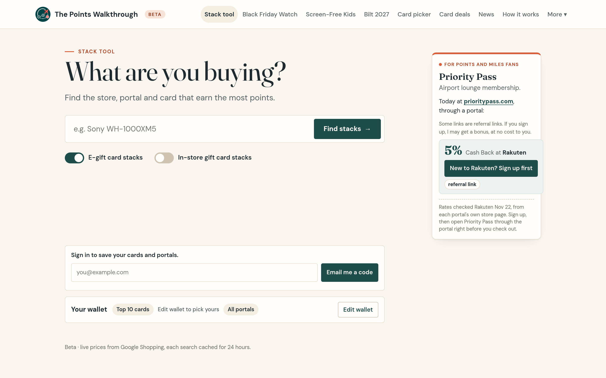
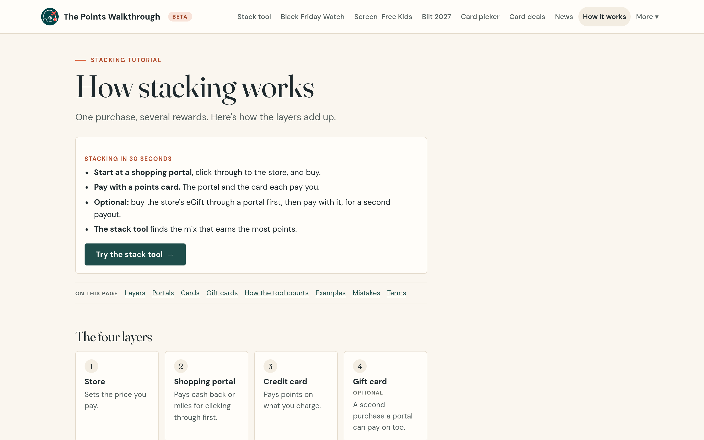
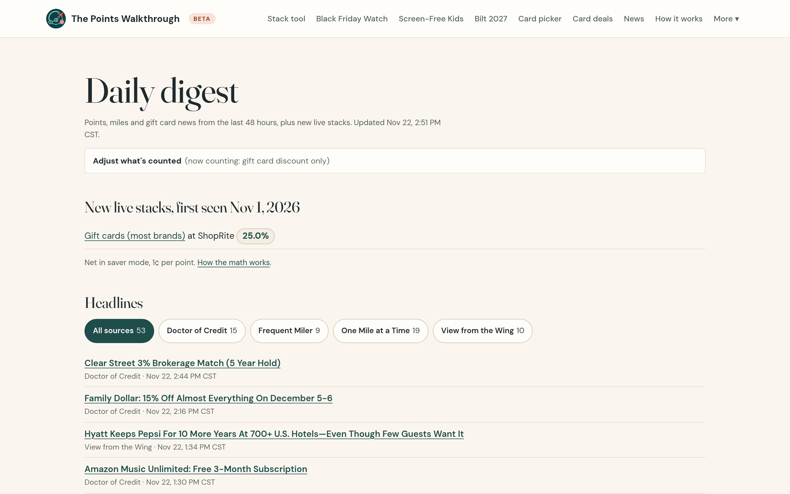

# The Points Walkthrough

A gift card and shopping-portal stacking calculator for points and miles fans.

**Live site:** [pointswalkthrough.com](https://pointswalkthrough.com)

## What it does

The Points Walkthrough helps you compare how to pay for a purchase so you can earn more points or cash back. Its **stack tool** (in beta) lets you search a product by name, model, UPC, or link, then see which combination of store, shopping portal, and credit card earns the most points, with the math shown.

You can include optional e-gift or in-store gift-card steps. A stack can have up to four layers:

1. **Store** — sets the price you pay
2. **Shopping portal** — pays cash back or miles for clicking through first
3. **Credit card** — pays points on what you charge
4. **Gift card (optional)** — a second purchase a portal can pay on too

The stack tool compares raw points only. It does not assign cents-per-point values. Cash back is shown in dollars and is not added to the points total. The site is educational and is not financial advice.

## Key features

- **[Stack tool](https://pointswalkthrough.com/) (beta).** Search a product, optionally include e-gift or in-store gift-card stacks, and compare results. You can sign in to save your cards and portals. The live site notes that it uses live prices from Google Shopping and caches each search for 24 hours.
- **[How stacking works](https://pointswalkthrough.com/how-the-math-works/).** A beginner tutorial on portals, card earn rates, gift-card stacks, and how the tool counts, with diagrams and worked examples.
- **[Daily digest](https://pointswalkthrough.com/digest/).** Points, miles, and gift card news from the last 48 hours, plus newly spotted live stacks.
- **[Card picker](https://pointswalkthrough.com/card-picker/).** Answer a short set of spending questions to get a month-by-month credit card plan based on published earn rates.
- **[Card deals](https://pointswalkthrough.com/card-deals/)** and **[confirmed points deals](https://pointswalkthrough.com/deals/).** Current public welcome offers and points news, checked against issuer or source pages.
- **[Bilt 2027 calculator](https://pointswalkthrough.com/tools/bilt-2027-calculator/).** Compare a year of Bilt points and hotel dollars across Housing-only, Flexible Bilt Cash, and the 2027 program.
- Seasonal guides currently on the site include [Black Friday Watch](https://pointswalkthrough.com/black-friday-watch/) and [holiday stacks for screen-free gifts](https://pointswalkthrough.com/screen-free-holiday-stacks/).

Rates shown in the stack tool come from the portals' public, signed-out pages, and card rates from issuer pages. Each step is dated.

## Screenshots

The stack tool on the homepage:

How stacking works:

The daily digest:

## Tech stack

[Astro](https://astro.build/) 5 static site, hosted on [Cloudflare Pages](https://pages.cloudflare.com/).

This repository is a public showcase only. It does not include the production source code.

## About

Built by Elizabeth Bowen, MD, a physician building tools with AI coding assistants.

Some links on the live site are referral links. If you sign up through them, the site owner may receive a bonus at no cost to you. Details are on the [disclosures](https://pointswalkthrough.com/disclosures/) page.
